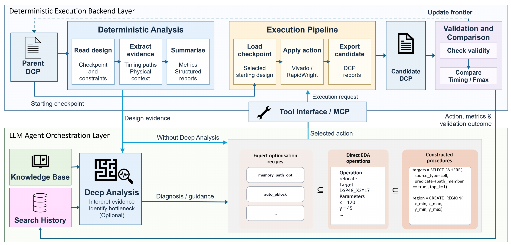
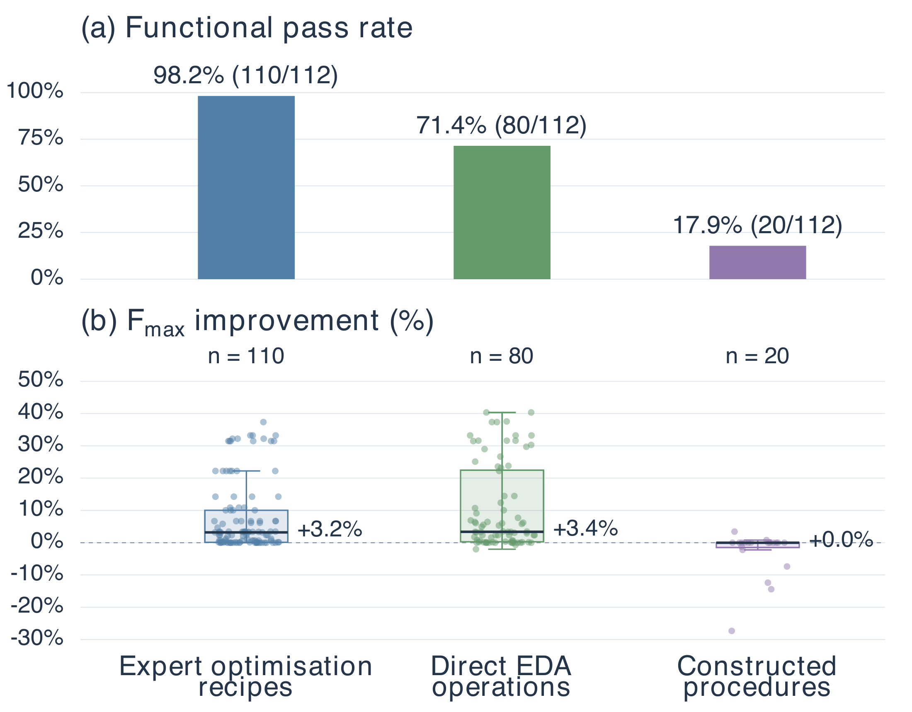
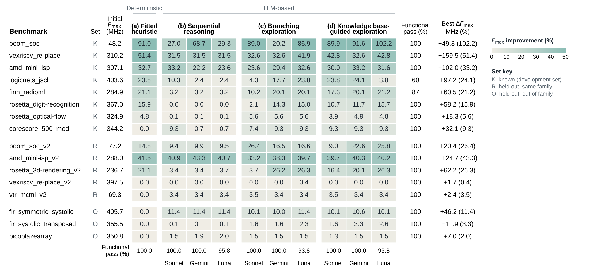

# LATCH

**LLM-Assisted Timing Closure Harness for Post-Route FPGA Optimisation**

[Quick start](#install-from-source) · [Harness API](docs/latch-harness.md) ·
[Experiments](#choose-an-interface) · [Paper results](#paper-results) ·
[Data](docs/latch-data-reproduction.md) · [Contributors](CONTRIBUTORS.md) · [Licensing](LICENSING.md)

LATCH combines reusable execution, scoring, validation and run records with
two separate research interfaces: control-language degrees of freedom (DoF)
and frontier-search ablation (S0–S3). Xilinx Vivado and RapidWright are the
current backend. A model is optional for fixed-proposal and mock work.

[](docs/assets/latch-overview.pdf)

*System overview from Figure 1 of the manuscript. Shared capabilities support
recipe selection, direct operations and constructed procedures; each study
owns its control protocol and validation schedule.*

LATCH builds on AMD's FPL26 contest software. See the
[file-level source credits](SOURCE_CREDITS.md#amd-origin-code-and-retained-declarations)
for upstream-derived components, retained notices and separately attributed
LATCH work; code attribution does not grant redistribution rights to benchmarks.

## Install from source

Use a complete source checkout and an editable installation. Retain the root
MCP servers, validation helpers and `scripts/`: physical execution requires
these source-checkout components. Python 3.12 is the physical-validation target;
package metadata allows >=3.10, but physical-tool compatibility needs separate
validation.

```bash
python3.12 -m venv .venv
.venv/bin/python -m pip install -e '.[test,analysis]'
export LATCH_PYTHON="$(pwd)/.venv/bin/python"
```

Use that interpreter's absolute path when calling modules from another working
directory. For physical runs also install `.[tools]` and externally install and
license Vivado 2025.1, Java 21.0.1 and RapidWright at the recorded gitlink
`2fc8b6aec859c20c04218573f9dda09db0a72e3f`. The checkout may have an
uninitialized submodule: set up that exact version, or configure an existing
installation at it.
Install only the chosen provider extra when needed (`openai`, `anthropic`
or `google`). Do not put credentials or license-server addresses in source or
JSON examples. See [tool setup](docs/latch-tools.md).

## First run: no tools or model

Create a fixture input and an independent workspace outside the source tree:

```bash
work=$(mktemp -d)
printf 'mock fixture, not a physical checkpoint\n' > "$work/input.dcp"
"$LATCH_PYTHON" -m optimizer_pipeline.apps.experiment "$work/input.dcp" \
  --mock --run-dir "$work/harness" \
  --custom-pipeline optimizer_pipeline.apps.experiment.pipelines:one_physical_transition
"$LATCH_PYTHON" -m experiments.dof --condition direct --mode mock \
  --output "$work/dof"
"$LATCH_PYTHON" -m experiments.ablation --condition S0 --mode mock \
  --output "$work/s0"
```

Mock output is a fixture, not an FPGA checkpoint, timing measurement or
functional certification. These supplied examples make no tool/model calls.
Arbitrary custom pipeline Python is not sandboxed by LATCH.

## Choose an interface

| Task | Entry | Guide |
|---|---|---|
| Compose a custom pipeline | `python -m optimizer_pipeline.apps.experiment` | [CLI, API and lifecycle](docs/latch-harness.md) |
| Use Python capabilities | `OptimizationConfig`, `bootstrap_run`, `resume_run` | [minimal API](docs/latch-harness.md#minimal-python-api) |
| Study recipe / direct / constructed control | `python -m experiments.dof` | [DoF protocol and inputs](experiments/dof/README.md) |
| Study S0–S3 frontier search | `python -m experiments.ablation` | [conditions and execution](experiments/ablation/README.md) |
| Process raw S0–S3 data | `python -m experiments.ablation.processing` | [processing scope](experiments/ablation/README.md#bounded-participant-processing-entry) |
| Analyse or redraw supplied data | `experiments.dof.analysis.*`, `experiments.ablation.analysis` | [data reproduction](docs/latch-data-reproduction.md) |

Studies configure shared harness capabilities and define their own conditions,
model choices, budgets, selection rules and validation timing.
[The code map](docs/latch-organization.md) explains extension points and
compatibility paths. Optional [acceptance utilities](experiments/acceptance/README.md)
provide developer checks.

## Outputs and interpretation

Supply explicit input/golden/validation material and a **new** output directory
for physical work. Recommended entries use explicit tool configuration and do
not discover `.env` files or choose a replacement model.

Managed runs store execution and validation facts in SQLite `run.db` with
derived JSON summaries. Read execution status, lightweight physical validity,
timing score, functional checks and research termination separately. A selected
file or exit code zero does not establish all of them. Sampled functional
simulation is not formal equivalence. Missing/unexecuted checks are not passes;
valid output can have zero or negative performance gain. API resume is explicit
and must not replay uncertain or already-submitted candidates.

## Paper results

### Control-language degrees of freedom

[](docs/assets/dof-results.pdf)

*Figure 5: recipe selection, direct operations and constructed procedures.
The manuscript reports 112 trials per condition across 16 designs and seven
models. Functional-pass rates are 98.2%, 71.4% and 17.9%, respectively.
Gain distributions include only functional-pass trials, including zero and
negative gains; they are not unconditional performance averages.*

### Search ablation

[](docs/assets/ablation-results.pdf)

*Figure 8: the heuristic reference (S0), sequential search (S1), branching
search (S2) and knowledge-guided search (S3). The table reports per-design
results, with best-of-three repeats as specified in the manuscript—not mean
performance. Click the figure for a vector PDF.*

These are manuscript figures, not results generated by the quick start.
See [figure provenance and interpretation](docs/assets/README.md) and
[data reproduction](docs/latch-data-reproduction.md) for material requirements.
The available historical curated package must not be assumed to reproduce
every value in this manuscript revision; in particular, the updated Pico
results require the corresponding revised data.

## Documentation and limitations

- The [DoF](experiments/dof/README.md) and [S0–S3](experiments/ablation/README.md)
  guides specify study conditions, budgets and validation schedules.
- [Data reproduction](docs/latch-data-reproduction.md) separates the DoF paper
  subset, full diagnostic corpus, S0–S3 processed/raw routes and new smoke.
  Complete raw reconstruction and some original physical-probe checkpoints
  remain missing; new smoke runs check execution rather than reproduce paper data.
- [Sources and permissions](SOURCE_CREDITS.md) identify upstream-derived
  components and retained notices. [Licensing](LICENSING.md) explains the
  Apache-2.0 code license, third-party terms and research materials.
- Physical coverage depends on design, materials and tool versions. Reports
  retain invalid proposals, failures and missing final outputs.

## Paper and acknowledgements

**LATCH: LLM-Assisted Timing Closure Harness for Post-Route FPGA Optimisation.**
The figures above correspond to the manuscript revision shared on 9 October
2026. A public paper link and final citation will be added when available;
no publication or acceptance status is asserted here.

LATCH builds on AMD's FPL26 contest software and uses Vivado and RapidWright.
See [source credits](SOURCE_CREDITS.md) for component-level origins,
modifications and third-party notices.

## License

LATCH's original code is licensed under [Apache-2.0](LICENSE.txt).
AMD-origin components retain their Apache-2.0 notices, and MCP SDK-derived
elements retain their [MIT terms](LICENSE-MCP-MIT.txt). Other dependencies and
research materials have their own terms; see [scope and exceptions](LICENSING.md).
